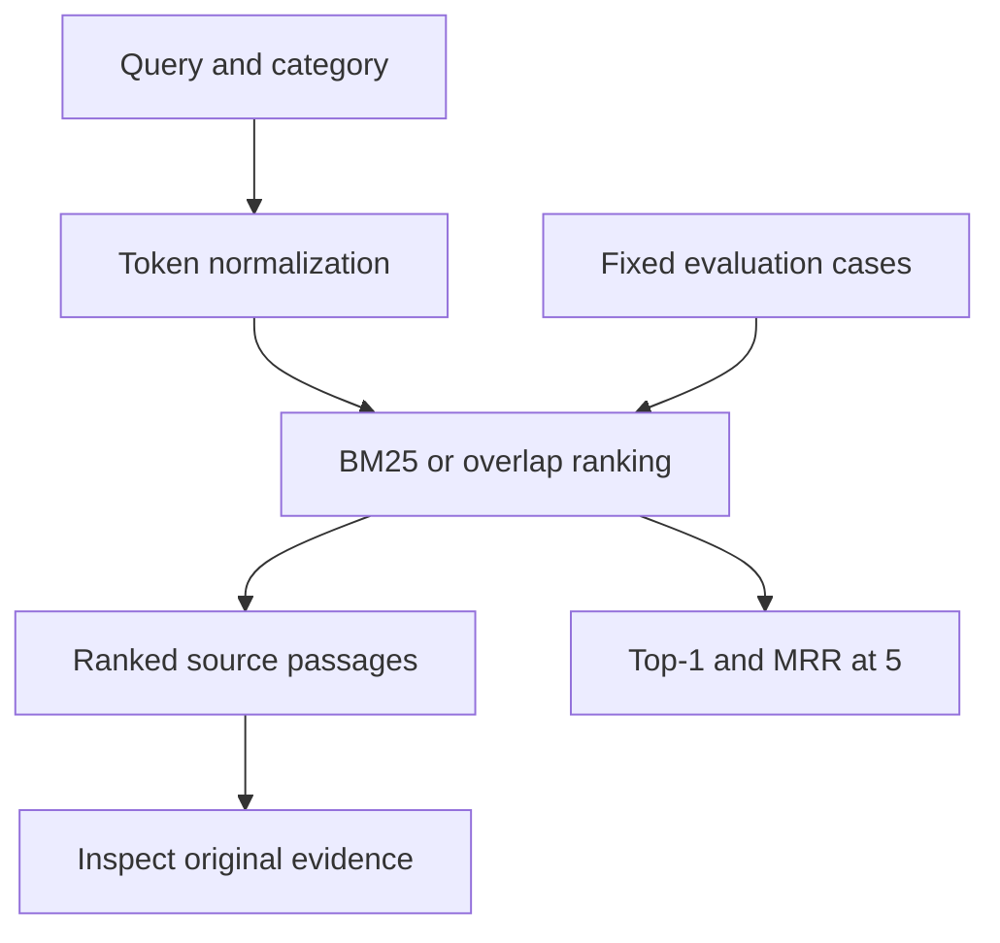

# SourceDesk
### Evidence before answers

A document retrieval workbench by **Neeli Yaswanth Kumar**. Search a fictional policy library, inspect matching passages, compare BM25 with keyword overlap, and evaluate a small set of queries.

This is an **independent portfolio project**, not company source code. It focuses on the retrieval stage of a knowledge assistant. No LLM, embeddings, paid APIs or account required.

## Quick start

Requires Python 3.10+ to serve the files. JavaScript tests require Node.js 18+.

```bash
python3 -m http.server 8000
# Open http://localhost:8000
```

```bash
node --test tests/search.test.js
python3 -m unittest discover -s tests -p 'test_*.py' -v
python3 search.py "remote schedules"
```

The Python CLI is a separate minimal baseline with three sample documents. The browser uses eight documents and provides category filtering, highlighting, imports and evaluation.

## Explore the app

1. Search for **lost laptop security**.
2. Open **Inspect full source** to see the evidence and matching tokens.
3. Switch from BM25 to **Keyword overlap** and compare the order.
4. Try a synonym-only query to see the limits of lexical search.
5. Open **Document library** and import a `.txt` file.
6. Run **Evaluation** to inspect top-1 accuracy and MRR@5 on the built-in sample.

Imported files stay in the current browser tab. There is no upload endpoint or external API call. Reloading removes imported files. Import limit: 20 files of up to 100 KB each. Imported text is rendered as text, not interpreted as HTML.

## Architecture



`search.js` contains ranking and evaluation as pure functions. `app.js` handles UI state and source inspection. `data.js` supplies fictional documents and expected sources. `search.py` provides the Python baseline. There are no runtime package dependencies.

## Ranking decisions

- BM25 accounts for term frequency, document frequency and length; parameters are k1=1.5 and b=0.75.
- Overlap counts distinct matching query tokens. It is a deliberately simple comparison.
- A document without a matching token is excluded.
- Exact score ties sort by source ID for deterministic results.
- Category filtering changes the corpus before scoring, so BM25 scores across categories are not directly comparable.
- Scores are not probabilities or confidence values.

## Evaluation boundaries

Six hand-written queries are closely aligned with the eight fictional documents. They are useful smoke checks and intentionally inspectable, but insufficient to establish real-world retrieval quality. Evaluation always uses the original sample library; imported documents do not contaminate this comparison.

No latency benchmark, production scale, security certification or model accuracy is claimed. The UI timer measures one local search in the current browser, not an end-to-end service SLA.

## Known limitations

Lexical matching misses synonyms, cannot reason across documents and may return irrelevant passages sharing query words. The app has no authentication, persistence, PDF parser, OCR, vector index, reranker or generated answers. Imported documents are not chunked; a long file is ranked as one document. The English tokenizer supports ASCII letters and digits.

## Next steps

Add a labelled evaluation dataset with paraphrases and negative questions; compare hybrid retrieval; introduce chunk-level indexing; add citation-aware generation only after retrieval quality is understood.

[Portfolio](https://kyaswanthneeli-stack.github.io/) · [LinkedIn](https://www.linkedin.com/in/yaswanthneeli-kumar-134a74414/)
